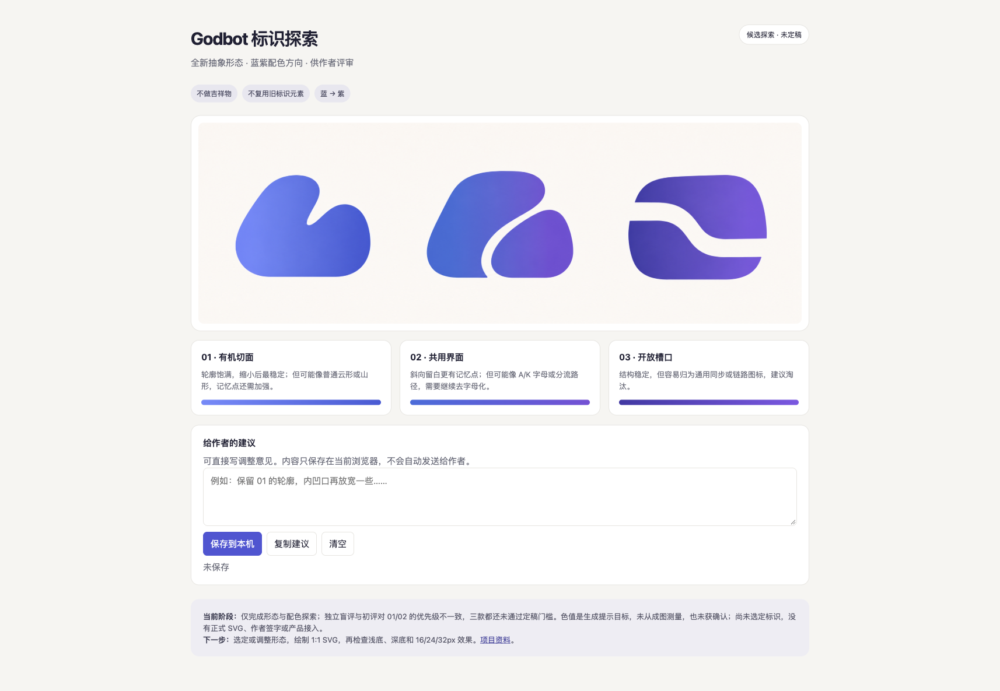

# Logo Brand Designer

**Design a logo with your AI assistant, from monochrome sketches to a transparent SVG.**

An open source skill for Codex, Claude Code, and other compatible assistants. Use it to create a product mark, revisit an existing identity, or adapt a mark to a plugin sidebar or browser tab.

[](https://github.com/webkubor/logo-brand-designer/releases/latest) [](https://github.com/webkubor/logo-brand-designer/actions/workflows/test.yml) [](LICENSE) [](https://webkubor.github.io/logo-brand-designer/)

[Website and showcase](https://webkubor.github.io/logo-brand-designer/en/) · [Local review workbench](references/workbench.md) · [Changelog](CHANGELOG.md) · [中文](README.md)

## Quick start

```bash
npx skills add webkubor/logo-brand-designer
```

Ask your assistant:

> Use logo-brand-designer for this project. Read the product brief, show me a few monochrome shapes, and wait for my choice before exploring color. Show the selected mark on light and dark backgrounds and at small sizes.

You can also clone the repo and run `./install.sh`. The offline review tools require Python 3.9+.

## How it works

1. Compare monochrome shapes and record why each direction was kept or dropped.
2. Keep the chosen outline while trying color treatments on light and dark backgrounds.
3. Choose options or write feedback in the local review workbench. Notes appear in the timeline.
4. Export transparent SVGs, color specifications, design notes, and an offline review page. Check small icons in the intended product surface.

## A real review session

This browser screenshot comes from the archived Godbot design exercise. The case preserves three blue and violet concepts and the feedback workflow.

[](examples/godbot-experiment/README.md)

## Brand mark gallery

<!-- logo-wall:start -->
<table>
  <tr><td align="center"><a href="https://webkubor.github.io/kyvault/"></a></td><td align="center"><a href="https://github.com/webkubor/nativecrew"></a></td><td align="center"><a href="https://music.museav.top/"></a></td><td align="center"><a href="https://wechat.webkubor.online/"></a></td><td align="center"><a href="https://wallpaper.webkubor.online/"></a></td></tr>
  <tr><td align="center"><a href="https://github.com/webkubor/claude-usage-statusline"></a></td><td align="center"><a href="https://github.com/webkubor/facet"></a></td><td align="center"><a href="https://github.com/webkubor/fovea"></a></td><td align="center"><a href="https://github.com/webkubor/free-imgbed"></a></td><td align="center"><a href="https://github.com/webkubor/harnessweight"></a></td></tr>
  <tr><td align="center"><a href="https://github.com/supercli-site/supercli"></a></td><td align="center"><a href="https://github.com/webkubor/vite-plugin-agent-eyes"></a></td><td align="center"><a href="https://xiaobai.supercli.site/"></a></td></tr>
</table>
<!-- logo-wall:end -->

[Brand asset catalog](https://github.com/webkubor/free-imgbed/blob/main/BRAND-ASSETS.md) · [Explore the full showcase](https://webkubor.github.io/logo-brand-designer/en/#cases) · [Skill instructions](SKILL.md) · [Offline review guide](references/reuse.md) · [Submit a project](https://github.com/webkubor/logo-brand-designer/issues/new?template=showcase.yml)

Code and documentation use the [MIT license](LICENSE). Product marks belong to their respective owners. See the [legal notice](https://webkubor.github.io/logo-brand-designer/legal/).
