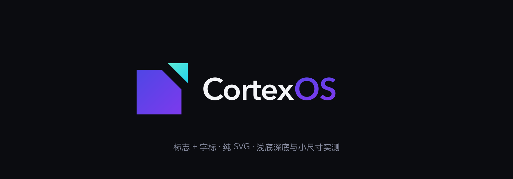
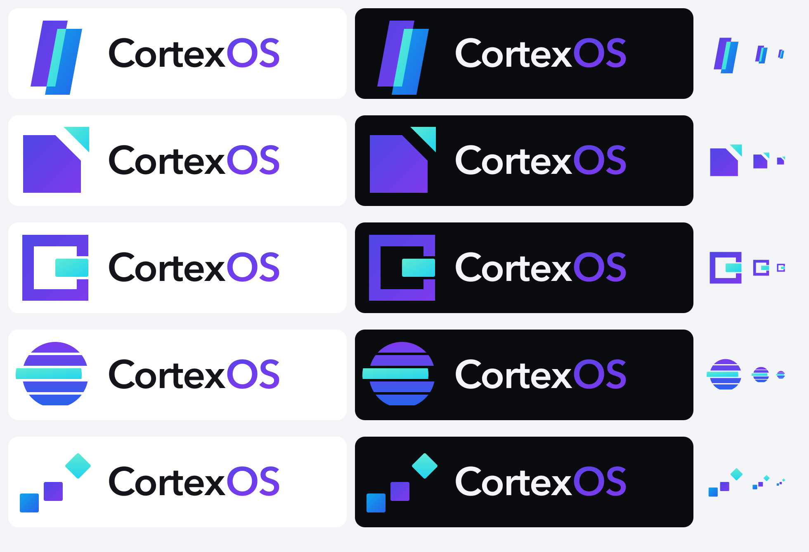
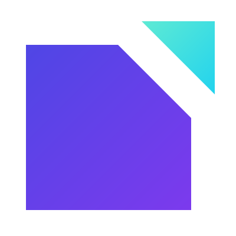
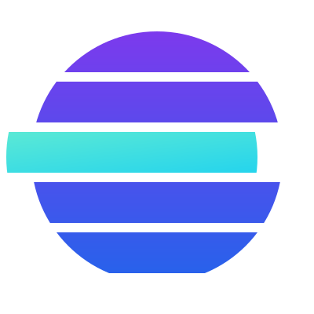
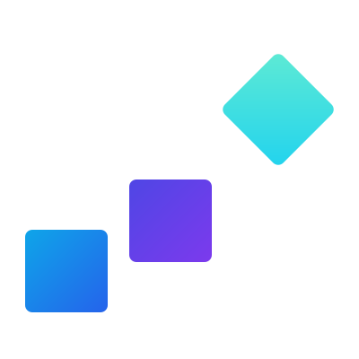

<div align="center">



# logo-brand-designer

[English](README.en.md) · [更新记录](CHANGELOG.md) · [Agent 索引](llms.txt) · [触发边界用例](evals/evals.json)

**让 AI Agent 做出真正的 logo，而不是一个发光的圆角方块。**

标志 + 字标 · 纯 SVG · 设计门槛 · 视觉模型盲审 · 离线评审页

[](SKILL.md)
[](LICENSE)
[](#安装)

</div>

---

## 它解决什么问题

让 Agent「做个 logo」，常见结果是这些：

- 圆环、星芒、六边形、神经网络——**平台图标库里的通用件**，换个品牌名照样能用
- 圆角方底板 + 发光图形——这是**应用图标**，不是 logo
- 黑白配一点蓝，「看起来有品位」，但**说不出颜色代表什么**
- 裁切、溢出、文字压图的展板，**没人看过就发给了用户**

这个 skill 把这些坑写成了硬门槛：每个候选先过「一个想法 / 换名测试 / 记忆点」三问，先做黑白剪影再上色，交付前必须过视觉模型盲审，最终交付是**标志 + 字标的锁定组合**，在浅底、深底、页头和小尺寸里都要成立。

## 示例：同一个品牌，五个不同的想法

下面是 skill 为 [CortexOS](https://github.com/cortexos-dev)（一个人管理项目、服务器和多个 AI Agent 的工作入口）产出的五套探索稿。每一行依次是：浅底横版、深底横版、标志 96 / 48 / 24px 实测。



| 方案 | 标志 | 一句话想法 |
|---|---|---|
| 交汇 `intersect` |  | 两片平行斜面错位相叠，重叠处是人与 Agent 交汇出的控制空间 |
| 切角 `corner` |  | 完整的方块是组织空间，被切下的一角向外推出，是秩序里的一次突破 |
| 出框 `breakout` |  | 粗框围出一个空间，核心从开口处穿出去，掌控与越界同时成立 |
| 光栅 `raster` |  | 五道平行光栅组成一个整体，中间一道错位，秩序里只有一处被打破 |
| 跃迁 `ascend` |  | 两级方块排成秩序，第三块转成菱形跃起，表示从排列到突破 |

每套都有 `mark.svg`、`lockup-light.svg`、`lockup-dark.svg`，全部由 [examples/cortexos/build.py](examples/cortexos/build.py) 用纯 SVG 生成，可以直接改坐标和配色重跑。

> 这些是演示 skill 能力的探索稿，**不是 CortexOS 的定稿品牌**。按 skill 的流程，定稿必须由品牌方本人确认。

## 工作流程

```text
读生产资料 ──▶ 想法三问 ──▶ 黑白剪影 ──▶ 配色有出处 ──▶ 锁定组合 ──▶ 自己看图 ──▶ 视觉模型盲审 ──▶ 用户确认 ──▶ 派生图标/接入
                 │                                                        │
                 └── 不过关：不出图                                       └── 被认成通用件 / 像模板 / 24px 认不出：淘汰重做
```

| 关卡 | 要求 |
|---|---|
| **先分清 logo 与图标** | logo = 标志 + 字标，平面无底板；应用图标是定稿后的派生物 |
| **想法三问** | 一句话说出只属于本产品的事实；换成竞品名不成立；能凭记忆画出来 |
| **拒绝通用件** | 圆环、靶心、星芒、晶体、层叠、取景框、`>_`、六边形、神经网络单独出现即视为模板 |
| **配色有依据** | 先盘点各端现有 token；说明颜色服务什么；黑白先成立，颜色只做增强 |
| **亲眼看图** | 检查裁切、拉伸、溢出、透明角、真实像素尺寸，坏展板不能发 |
| **视觉模型盲审** | 不告诉设计意图先问「像什么」，再做品牌联想和换名测试，附模型原话 |
| **用户确认** | 候选、推荐与批准严格区分；被否决的方案不因旧目标重新上线 |

完整规则见 [SKILL.md](SKILL.md)。

## 安装

```bash
git clone https://github.com/webkubor/logo-brand-designer.git
cd logo-brand-designer
./install.sh
```

脚本会识别本机已有的运行时目录（Claude Code / Codex / `~/.agents` / Gemini / DSH / Magpie / Hermes），默认软链，改源码即时生效。

| 选项 | 作用 |
|---|---|
| `--list` | 只看会装到哪里，不改动 |
| `--target claude` | 只装到指定运行时 |
| `--copy` | 用拷贝代替软链 |
| `--uninstall` | 卸载 |

也可以用生态工具安装：

```bash
npx skills add webkubor/logo-brand-designer
```

装好后在 Agent 中重新加载 skills。ZCode 的 `~/.zcode/skills/` 同名副本优先级更高，需要一并核对。

## 使用

```text
用 logo-brand-designer 给当前项目做 logo：先读 README 和现有主题 token，
给我 3 个过了设计门槛的方向，每个都是标志 + 字标的横版锁定，
附浅底、深底、页头效果和 24px 实测，以及视觉模型盲审的原话。
```

已有品牌资产时：

```text
用 logo-brand-designer 重设计现有 logo：保留我给的 token 和理念，
新旧对照，说明哪些保留、哪些是新建议，生成离线评审页。
```

已有 logo、只需要侧栏或应用图标时，保留既有品牌识别线索，先核实宿主图标尺寸、背景及主题切换方式，再在实际槽位验证 16px 和 24px。评审 manifest 可选填 `iconAsset`，页面会提供两个尺寸的预览；实际宿主截图仍需单独采集。

## 0.6.0 实际演示

下面展示本版生成的评审页：切换浅底、深底与棋盘背景，并预览应用图标的 24px 和 16px 版本。演示来自[可复现示例](examples/release-0.6.0/)，实际宿主的渲染仍需要单独验证。

https://github.com/user-attachments/assets/e81281ac-5d8d-4eca-b85b-6f6cbc04034c


[下载 MP4 演示](examples/release-0.6.0/media/review-0.6.0.mp4) · [深色评审页截图](examples/release-0.6.0/screenshots/review-dark.png)

## 离线评审页

生成器只用 Python 3.9+ 标准库。[manifest 示例](references/manifest-example.json) 的素材和来源路径均为占位，需替换为自行准备的真实文件。准备好 `delivery/manifest.json` 后：

```bash
SKILL_DIR="$HOME/.agents/skills/logo-brand-designer"
python3 "$SKILL_DIR/scripts/build_review.py" \
  --manifest ./delivery/manifest.json \
  --out ./delivery/review.html
```

浏览器打开 `review.html`，可离线切换浅底 / 深底 / 棋盘格与 32 / 64 / 128px，下载素材和 JSON，复制含完整 SVG 的任务描述。manifest 字段见 [references/reuse.md](references/reuse.md)。

生成器只检查结构，不渲染像素。留白、颜色和小尺寸可辨性要用渲染器和浏览器实测，截图存进交付目录 `screenshots/`。

## 开发

```bash
python3 -m unittest discover -s tests -v   # 评审页生成器测试，CI 同命令
python3 examples/cortexos/build.py         # 重建示例（需要 rsvg-convert）
```

## License

[MIT](LICENSE) © webkubor
